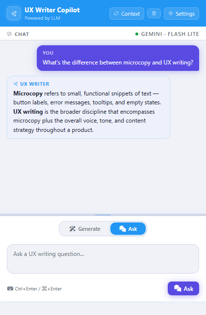

# Figma UX Writer Copilot

A Figma plugin that generates AI-powered wording alternatives for any selected text node. The plugin reads the selected text, the surrounding Figma document context (design system, screens, existing page copy), and forwards everything to the chosen AI provider so every suggestion is contextually coherent with the current file.

Supported providers:
- **Gemini** — direct Google Gemini API with your own Google AI Studio key (BYOK) — **default**.
- **OpenAI** — direct Chat Completions API with your own OpenAI key (BYOK).
- **Anthropic** — direct Messages API with your own Anthropic key (BYOK).

---

## Screenshots

| Onboarding | Configure provider | Functional context | Ready |
|:---:|:---:|:---:|:---:|
|  |  |  |  |

| Main view (Generate) | Ask mode | Settings |
|:---:|:---:|:---:|
|  |  |  |

> Screenshots are generated by `scripts/gen-screenshots.py`. Run `py scripts/gen-screenshots.py` after any UI change to keep them up to date.

---

## Table of contents

1. [Architecture overview](#architecture-overview)
2. [UI layout](#ui-layout)
3. [Two-process model](#two-process-model)
4. [Directory structure](#directory-structure)
5. [Core concepts](#core-concepts)
6. [Authentication & BYOK](#authentication--byok)
7. [Available providers and models](#available-providers-and-models)
8. [Interaction modes](#interaction-modes)
9. [Functional context](#functional-context)
10. [Custom skills (`copilot.json`)](#custom-skills-copilotjson)
11. [Data flow — single request](#data-flow--single-request)
12. [Build & develop](#build--develop)
13. [Testing](#testing)
14. [Key types quick reference](#key-types-quick-reference)

---

## Architecture overview

```
┌─────────────────────────────────────────────┐
│  Figma Plugin Sandbox  (main.ts / code.js)  │
│  • Reads Figma document via Figma API        │
│  • Reads the selected text node              │
│  • Writes approved copy back to text nodes   │
│  • Communicates with UI via postMessage      │
└────────────────┬────────────────────────────┘
                 │ postMessage (JSON)
┌────────────────▼────────────────────────────┐
│  Plugin iframe  (ui.ts → dist/ui.js)         │
│  • Chat interface + mode toggle              │
│  • Provider / model / alternatives count     │
│  • Functional context + custom skills        │
│  • Routes requests to the selected provider  │
└──────┬──────────────────┬───────────────────┘
       │ Gemini API   │ OpenAI / Anthropic
┌──────▼──────┐  ┌────▼──────────────────────┐
│ Gemini API  │  │  api.openai.com  /         │
│ (direct)    │  │  api.anthropic.com (BYOK)  │
└─────────────┘  └────────────────────────────┘
```

The provider is selected in the **Provider** dropdown. Each provider has its own set of models and API key field. Keys are persisted per-provider in the plugin iframe's `localStorage` and never committed to source code.

---

## UI layout

### Main view (default)

| Area | Content |
|------|---------|
| **Header** | Brand logo, Context refresh button, Clear chat button, **Settings** button |
| **Info bar** | Connection dot (🟠 no key / 🟢 ready) + current provider · model label |
| **Chat** | Scrollable conversation history; shows a placeholder when empty |
| **Mode toggle** | **Generate** tab (generates copy alternatives) · **Ask** tab (conversational UX writing Q&A) |
| **Input** | Prompt textarea · **Alternatives** count input (Generate mode) · **Generate / Ask** button · Ctrl+Enter shortcut |

### Settings view (full-screen overlay)

| Section | Content |
|---------|---------|
| **Model Configuration** | Provider selector, Model selector, API key input with show/hide toggle |
| **Functional Context** | Free-text textarea to describe your product/industry/tone — automatically injected into every generation |
| **Custom Skills** | Drag-and-drop zone for `copilot.json` files + loaded skills summary |
| **Developer** | Debug mode checkbox (logs prompts + AI responses to the browser console) |

---

## Two-process model

Figma plugins run in two separate JavaScript contexts that can only talk to each other through `postMessage`.

| File | Context | Capabilities |
|------|---------|--------------|
| `src/main.ts` → `dist/code.js` | Figma plugin sandbox | Full Figma API access; no DOM; no `fetch` |
| `src/ui.ts` → `dist/ui.js` | Sandboxed iframe | DOM + `fetch`; no direct Figma API |

Message types are defined in `src/types/ui-types.ts` under `UIToPluginMessage` and `PluginToUIMessage`.

---

## Directory structure

```
src/
├── main.ts                    # Plugin controller (Figma sandbox)
├── ui.ts                      # UI logic (iframe)
├── types/
│   └── ui-types.ts            # All shared TypeScript types
├── providers/
│   ├── llm-provider.ts        # LLMProvider interface
│   ├── gemini-provider.ts     # Direct Google Gemini API (default)
│   ├── openai-provider.ts     # Direct OpenAI Chat Completions
│   └── anthropic-provider.ts  # Direct Anthropic Messages API
├── services/
│   ├── ai-service.ts          # Provider factory + AIService (generateAlternatives, ask)
│   ├── context-engine.ts      # Extracts design system + selected text from Figma doc
│   └── custom-agent-registry.ts  # Manages user-provided custom skills
├── agents/
│   └── ux-writer-agent.ts     # UX writer agent: system prompt + generate() method
├── data/
│   └── skills-library.ts      # Reserved for future bundled skills (currently empty)
└── __tests__/                 # Jest unit tests
    ├── providers.test.ts
    ├── ai-service.test.ts
    └── custom-agent-registry.test.ts
```

---

## Core concepts

### DocumentContext

Before every generation, the plugin sandbox scans the open file via `src/services/context-engine.ts` and sends a `DocumentContext` object to the iframe:

```ts
interface DocumentContext {
  designSystem: {
    components: string[]; // names of all COMPONENT nodes
    colors: string[];     // all paint style names
    textStyles: string[]; // all text style names
  };
  screens: string[];          // names of top-level FRAMEs
  pages: string[];            // names of all PAGEs
  pageTextContext: ScreenTextContext[]; // all text entries on current page
  selectedText: SelectedTextContext | null; // currently selected text node
}
```

### SelectedTextContext (the primary input)

```ts
interface SelectedTextContext {
  characters: string;        // raw text of the selected node
  role: TextRole;            // "heading" | "button" | "body" | "label" | …
  fontSize: number | "mixed";
  fontFamily: string;
  charCount: number;
  insideComponent: boolean;
  screenName: string | null; // name of the parent top-level frame, if any
}
```

### TextAlternative (the AI's output format)

```ts
interface TextAlternative {
  text: string;        // the proposed copy
  rationale?: string;  // short explanation of the writing choice
}
```

The AI is instructed to return a JSON array of `TextAlternative` objects. Each is shown in the chat with an **Apply** button. Clicking **Apply** sends an `ApplyTextMessage` to the sandbox, which writes the text directly into the selected `TextNode` in Figma.

---

## Authentication & BYOK

The plugin supports three providers, each with its own key:

### Gemini (default)

Uses a **Google AI Studio API key** (`AIza…`).

1. Go to **aistudio.google.com/apikey**.
2. Click **Create API key**.
3. Copy the key (`AIza…`) and paste it into the **API Key** field in the plugin **Settings**.

> ✅ A free tier is available with generous rate limits.

### OpenAI (BYOK)

Uses an **OpenAI API key** (`sk-…`).

1. Go to **platform.openai.com/api-keys**.
2. Click **Create new secret key**.
3. Copy the key and paste it into the **API Key** field when **OpenAI** is selected as the provider.

### Anthropic (BYOK)

Uses an **Anthropic API key** (`sk-ant-…`).

1. Go to **console.anthropic.com → API Keys**.
2. Click **Create key**.
3. Copy the key and paste it into the **API Key** field when **Anthropic** is selected as the provider.

**Security:** Keys are stored in `localStorage` within the plugin iframe. They are never committed to source code or sent to any endpoint other than the respective provider's official API.

---

## Available providers and models

### Gemini (default)

| UI label | API model id | Best for |
|----------|-------------|----------|
| Gemini 3.1 Flash Lite *(default)* | `gemini-3.1-flash-lite-preview` | Fast, cost-efficient generation |
| Gemini 3 Pro | `gemini-3-pro` | Higher-quality suggestions |

### OpenAI

| UI label | API model id |
|----------|-------------|
| GPT-5 mini | `gpt-5-mini` |
| GPT-5 | `gpt-5` |
| GPT-5.2 | `gpt-5.2` |
| GPT-5.3 | `gpt-5.3` |
| Codex | `codex` |

### Anthropic

| UI label | API model id |
|----------|-------------|
| Claude Haiku 4.5 | `claude-haiku-4-5` |
| Claude Sonnet 4.6 | `claude-sonnet-4-6` |
| Claude Opus 4.6 | `claude-opus-4-6` |

---

## Interaction modes

| Mode | Button | What it does |
|------|--------|--------------|
| **✍️ Generate** | `Generate` | Reads the selected text node, sends the prompt to the UX writer agent, and returns N wording alternatives |
| **💬 Ask** | `Ask` | Sends the question to the AI for conversational UX writing advice — no node is modified |

**Generate mode** is the default. Switch to **Ask mode** to get writing advice, tone guidance, or microcopy inspiration without committing to any change.

Ctrl+Enter / ⌘+Enter always submits the current mode's action.

In **Ask mode**, the Alternatives count input is hidden to keep the interface clean.

---

## Functional context

Set a free-text description of your product in **Settings → Functional Context**. This text is automatically appended to the AI system prompt on every generation.

**Example:**
> We are building a B2B SaaS for HR managers in mid-sized companies. Our tone is professional but approachable. Users need clear, action-oriented labels with minimal jargon.

Custom skill `promptModifier` strings from `copilot.json` are always appended alongside the functional context.

---

## Custom skills (`copilot.json`)

Drop a `copilot.json` file into the plugin panel (**Settings → Custom Skills**) to register writing prompt modifiers without TypeScript.

```jsonc
{
  "version": "1",
  "skills": [
    {
      "id": "british-english",
      "name": "British English",
      "promptModifier": "Use British English spelling and grammar conventions throughout."
    },
    {
      "id": "plain-language",
      "name": "Plain Language",
      "promptModifier": "Use plain language — short sentences, active voice, no jargon, Flesch reading ease above 60."
    }
  ]
}
```

Custom skill `promptModifier` strings are appended to the UX writer agent's system prompt. The registry persists to `localStorage` so configs survive plugin restarts.

---

## Data flow — Generate mode

```
User selects a text node in Figma
User types prompt → handleGenerate() in ui.ts  [Generate tab active]
  │
  ├─ postMessage({ type: "get-context" }) → main.ts
  │     └─ context-engine.ts extracts DocumentContext (incl. selectedText)
  │     └─ postMessage({ type: "context-ready", context })
  │
  ├─ uxWriterAgent.generate(prompt, count, context, modelConfig, history, functionalContext)
  │     └─ aiService.generateAlternatives(prompt, count, agentPrompt, context, config, history)
  │           └─ createProvider(config)  → LLMProvider instance
  │                 └─ provider.chat(messages, modelId)
  │                       ├─ GeminiProvider   → generativelanguage.googleapis.com
  │                       ├─ OpenAIProvider   → api.openai.com
  │                       └─ AnthropicProvider → api.anthropic.com
  │                                ← JSON array of TextAlternative[]
  │
  └─ appendAlternativesMessage()  → shows alternatives in chat with [Apply] buttons
        │
        └─ on "Apply" click: postMessage({ type: "apply-text", text })
              └─ main.ts → figma.loadFontAsync() → textNode.characters = text
```

## Data flow — Ask mode

```
User types question → handleAsk() in ui.ts  [Ask tab active]
  │
  ├─ aiService.ask(question, context, modelConfig, history)
  │     └─ createProvider(config)  → LLMProvider instance
  │           └─ provider.chat(messages, modelId)   ← conversational UX writing prompt
  │                 ← plain-text answer (no JSON, Figma doc untouched)
  │
  └─ appendAssistantMessage()  (show answer in chat)
```

---

## Build & develop

```bash
npm install          # install dev dependencies
npm run build        # one-off production build → dist/
npm run watch        # rebuild on file change (esbuild watch mode)
npm run typecheck    # TypeScript type-check without emitting
npm run lint         # ESLint (zero warnings policy)
npm test             # Jest unit tests
```

Load the plugin in Figma:

1. Open Figma → **Plugins → Development → Import plugin from manifest…**
2. Select `manifest.json` at the repository root.
3. Run **npm run watch** so the plugin auto-rebuilds as you edit.

---

## Testing

Tests live in `src/__tests__/` and use Jest + ts-jest. There is no Figma API mock — the plugin sandbox (`main.ts`) is intentionally excluded from the test suite.

```bash
npm test                      # run all tests
npm test -- --watch           # watch mode
npm test -- providers         # run provider suite only
npm test -- ai-service        # run AI service suite only
```

---

## Key types quick reference

```ts
// src/types/ui-types.ts

type LLMProvider = "gemini" | "openai" | "anthropic";

interface TextAlternative {
  text: string;
  rationale?: string;
}

interface SelectedTextContext {
  characters: string;
  role: TextRole;
  fontSize: number | "mixed";
  fontFamily: string;
  charCount: number;
  insideComponent: boolean;
  screenName: string | null;
}

interface GenerateAlternativesInput {
  prompt: string;
  count: number;
  context: DocumentContext;
  modelConfig: ModelConfig;
  history: ChatMessage[];
  functionalContext?: string;
}

interface CustomSkillConfig {
  id: string;
  name: string;
  promptModifier: string; // appended to every agent system prompt
}

// Messages between iframe ↔ plugin sandbox
type UIToPluginMessage  = GetContextMessage | GetSettingsMessage | SaveSettingsMessage
                        | GetOnboardingStatusMessage | SetOnboardingDoneMessage | ApplyTextMessage;
type PluginToUIMessage  = ContextReadyMessage | SettingsLoadedMessage | OnboardingStatusMessage
                        | TextAppliedMessage | ErrorMessage | NotifyMessage;
```
