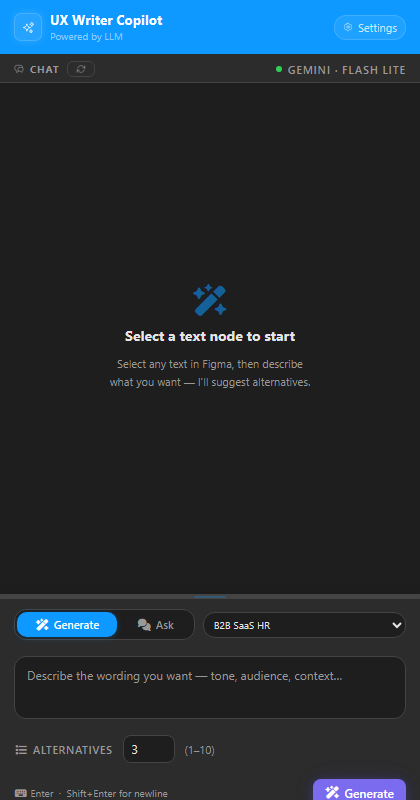
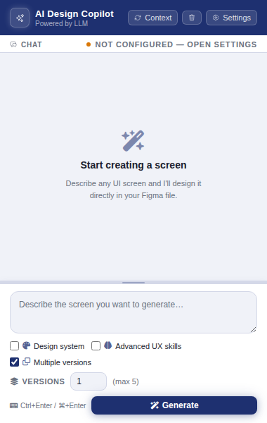
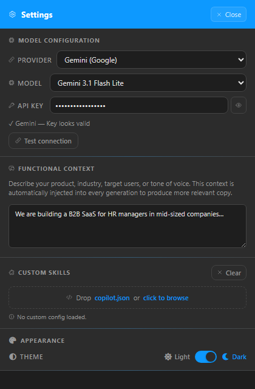
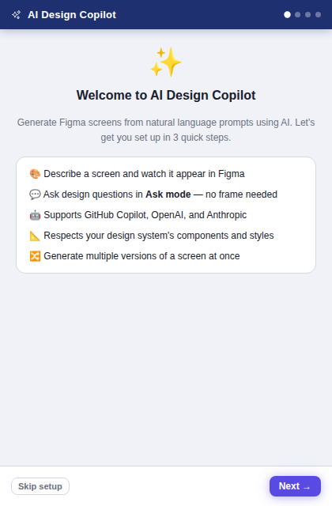
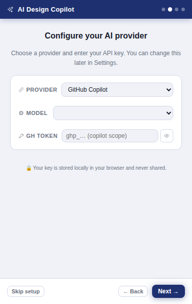
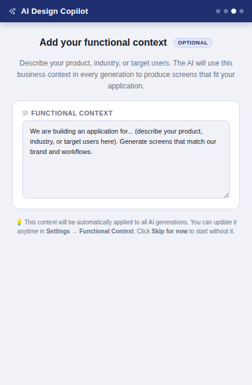
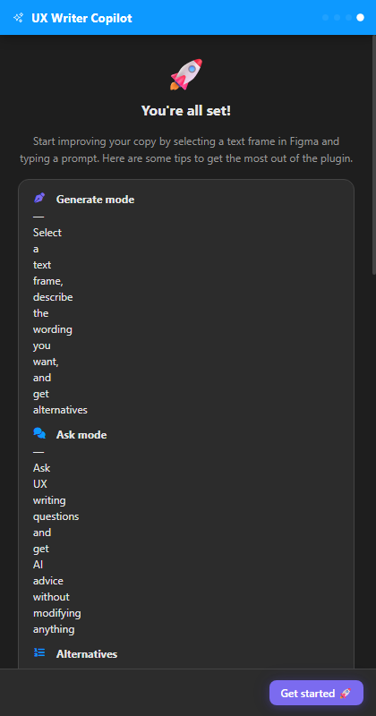

# Figma AI Design Copilot

A Figma plugin that turns natural-language prompts into Figma frames using AI. The plugin reads the open document's design system (components, colours, text styles, existing screens) and forwards that context to the chosen AI provider so every generated frame is coherent with the current file.

Supported providers:
- **GitHub Copilot** — multi-model proxy (GPT, Claude, Gemini) via a GitHub PAT.
- **OpenAI** — direct Chat Completions API with your own OpenAI key (BYOK).
- **Anthropic** — direct Messages API with your own Anthropic key (BYOK).

---

## Screenshots

<table>
  <tr>
    <td align="center" width="33%">
      <strong>Main view — empty chat</strong><br/>
      Centered "Start creating a screen" placeholder, checkboxes above Generate
      <br/><br/>
      
    </td>
    <td align="center" width="33%">
      <strong>Main view — Multiple versions</strong><br/>
      Versions counter revealed by the checkbox, Generate at bottom
      <br/><br/>
      
    </td>
    <td align="center" width="33%">
      <strong>Settings — Model &amp; Custom Skills</strong><br/>
      Provider, model, API key, functional context, skills
      <br/><br/>
      
    </td>
  </tr>
</table>

---

## Table of contents

1. [Screenshots](#screenshots)
2. [Onboarding](#onboarding)
3. [Architecture overview](#architecture-overview)
4. [UI layout](#ui-layout)
5. [Two-process model](#two-process-model)
6. [Directory structure](#directory-structure)
7. [Core concepts](#core-concepts)
8. [Authentication & BYOK](#authentication--byok)
9. [Available providers and models](#available-providers-and-models)
10. [Generation modes](#generation-modes)
11. [Functional context](#functional-context)
12. [Skills](#skills)
13. [Custom skills (`copilot.json`)](#custom-skills-copilotjson)
14. [External skills library](#external-skills-library)
15. [Data flow — single request](#data-flow--single-request)
16. [Build & develop](#build--develop)
17. [Testing](#testing)
18. [Key types quick reference](#key-types-quick-reference)

---

## Onboarding

On first launch the plugin automatically shows a 3-step onboarding overlay (plus a completion screen) to help new users get up and running without opening Settings manually.

<table>
  <tr>
    <td align="center" width="25%">
      <strong>Step 1 — Welcome</strong><br/>
      Introduction to the plugin's capabilities
      <br/><br/>
      
    </td>
    <td align="center" width="25%">
      <strong>Step 2 — Configure provider</strong><br/>
      Pick provider, model, and enter API key
      <br/><br/>
      
    </td>
    <td align="center" width="25%">
      <strong>Step 3 — Functional context</strong> <em>(optional)</em><br/>
      Describe your product so the AI generates relevant screens
      <br/><br/>
      
    </td>
    <td align="center" width="25%">
      <strong>You're all set!</strong><br/>
      Usage tips and the final dismissal screen
      <br/><br/>
      
    </td>
  </tr>
</table>

The onboarding is shown **only once** (on first install). Settings entered in step 2 are immediately applied to the plugin. The functional context entered in step 3 is saved to `Settings → Functional Context` and automatically injected into every generation. The onboarding can be re-triggered by clearing `localStorage` (key: `copilot_onboarding_done`).

---

## UI layout

The plugin UI is split into two distinct views:

### Main view (default)

| Area | Content |
|------|---------|
| **Header** | Brand logo, Context refresh button, Clear chat button, **Settings** button |
| **Info bar** | Connection dot (🟠 no key / 🟢 ready) + current provider · model label |
| **Chat** | Scrollable conversation history; shows a centered "Start creating a screen" placeholder when empty |
| **Input** | Prompt textarea · **Design system**, **Advanced UX skills**, **Multiple versions** checkboxes (above generate) · **Generate** button (bottom-left) · Ctrl+Enter shortcut hint |

### Settings view (full-screen overlay)

Clicking the **Settings** button opens a full-screen overlay that completely covers the main view — preventing any accidental interaction with the chat while configuring the plugin.

| Section | Content |
|---------|---------|
| **Model Configuration** | Provider selector, Model selector, API key input with show/hide toggle |
| **Functional Context** | Free-text textarea to describe your product/industry — automatically injected into every generation |
| **Custom Skills** | Drag-and-drop zone for `copilot.json` files + loaded skills summary |
| **Skills Library** | 28 bundled UX/design skills tags + Update (remote fetch) / Clear buttons |

The Settings overlay is closed with the **Close** button in its header. Any changes to provider/model/API key are reflected immediately in the info bar on the main page.

---

## Architecture overview

```
┌─────────────────────────────────────────────┐
│  Figma Plugin Sandbox  (main.ts / code.js)  │
│  • Reads Figma document via Figma API        │
│  • Creates frames from AI-generated JSON     │
│  • Communicates with UI via postMessage      │
└────────────────┬────────────────────────────┘
                 │ postMessage (JSON)
┌────────────────▼────────────────────────────┐
│  Plugin iframe  (ui.ts → dist/ui.js)         │
│  • Chat interface                            │
│  • Provider / model / generation mode select │
│  • Functional context + custom skills        │
│  • Routes requests to the selected provider  │
└──────┬─────────────────┬────────────────────┘
       │ GitHub Copilot  │ OpenAI / Anthropic
┌──────▼──────┐  ┌───────▼──────────────────────┐
│ Copilot API │  │  api.openai.com  /  api.anthro │
│ (proxy)     │  │  pic.com  (direct, BYOK)       │
└─────────────┘  └──────────────────────────────┘
```

The provider is selected in the **Provider** dropdown. Each provider has its own set of models and API key field. Keys are persisted per-provider in the plugin iframe's `localStorage` and never committed to source code.

---

## Two-process model

Figma plugins run in two separate JavaScript contexts that can only talk to each other through `postMessage`.

| File | Context | Capabilities |
|------|---------|--------------|
| `src/main.ts` → `dist/code.js` | Figma plugin sandbox | Full Figma API access; no DOM; no `fetch` |
| `src/ui.ts` → `dist/ui.js` | Sandboxed iframe | DOM + `fetch`; no direct Figma API |

Message types are defined in `src/types/ui-types.ts` under `UIToPluginMessage` and `PluginToUIMessage`.

---

## Directory structure

```
src/
├── main.ts                    # Plugin controller (Figma sandbox)
├── ui.ts                      # UI logic (iframe)
├── types/
│   └── ui-types.ts            # All shared TypeScript types
├── providers/
│   ├── llm-provider.ts        # LLMProvider interface
│   ├── github-copilot-provider.ts  # GitHub Copilot proxy
│   ├── openai-provider.ts     # Direct OpenAI Chat Completions
│   └── anthropic-provider.ts  # Direct Anthropic Messages API
├── services/
│   ├── ai-service.ts          # Provider factory + AIService (orchestrator)
│   ├── context-engine.ts      # Extracts design system from Figma doc
│   ├── figma-builder.ts       # Converts AI JSON → Figma nodes
│   ├── custom-agent-registry.ts  # Manages user-provided agents/skills
│   └── skills-library-service.ts # Fetches external UX skills from GitHub
├── agents/
│   ├── ux-designer-agent.ts   # Default full-featured agent
│   ├── design-system-agent.ts # Strict design-system-mapping agent
│   └── custom-agent.ts        # Runs a user-defined copilot.json agent
├── skills/
│   ├── generate-screen.ts     # Skill: single screen generation
│   ├── generate-variants.ts   # Skill: multi-variant generation
│   └── apply-design-system.ts # Skill: map elements to design system components
├── data/
│   └── skills-library.ts      # 28 bundled UX/product-design frameworks
└── __tests__/                 # Jest unit tests (80 tests)
    ├── providers.test.ts      # Provider unit tests (NEW)
    └── …
```

---

## Core concepts

### DocumentContext

Before every generation, the plugin sandbox scans the open file via `src/services/context-engine.ts` and sends a `DocumentContext` object to the iframe:

```ts
interface DocumentContext {
  designSystem: {
    components: string[]; // names of all COMPONENT nodes
    colors: string[];     // all paint style names
    textStyles: string[]; // all text style names
  };
  screens: string[];      // names of top-level FRAMEs
  pages: string[];        // names of all PAGEs
}
```

This context is injected into every system prompt so the AI can reference existing components and colours.

### UIScreen (the AI's output format)

The AI is instructed to return a JSON array of `UIScreen` objects:

```ts
interface UIScreen {
  name: string;
  layout: "vertical" | "horizontal" | "none";
  elements: UIElement[];
  width?: number;  // default 390 (mobile)
  height?: number; // default 844
}

interface UIElement {
  type: "text" | "button" | "input" | "card" | "image" | "icon"
      | "divider" | "header" | "footer" | "nav" | "list"
      | "modal" | "tab" | "badge" | "avatar" | "container";
  value?: string;
  component?: string; // design system component name
  children?: UIElement[];
  style?: Record<string, string>;
}
```

`src/services/figma-builder.ts` walks this tree and creates the corresponding Figma nodes.

---

## Authentication & BYOK

The plugin supports three providers, each with its own key:

### GitHub Copilot (default)

Uses a **GitHub Personal Access Token (classic)** with the `copilot` scope.

1. Go to **github.com → Settings → Developer settings → Personal access tokens → Tokens (classic)**.
2. Click **Generate new token (classic)**.
3. Select the **`copilot`** scope (under *GitHub Copilot*).
4. Copy the token (`ghp_…`) and paste it into the **GH Token** field in the plugin **Settings**.

> **Requirement:** A GitHub account with an active [GitHub Copilot subscription](https://github.com/features/copilot#pricing).

### OpenAI (BYOK)

Uses an **OpenAI API key** (`sk-…`).

1. Go to **platform.openai.com/api-keys**.
2. Click **Create new secret key**.
3. Copy the key and paste it into the **API Key** field when **OpenAI** is selected as the provider.

> Ensure your account has sufficient credits. Errors 401/429 are surfaced in the chat with a descriptive message.

### Anthropic (BYOK)

Uses an **Anthropic API key** (`sk-ant-…`).

1. Go to **console.anthropic.com → API Keys**.
2. Click **Create key**.
3. Copy the key and paste it into the **API Key** field when **Anthropic** is selected as the provider.

> Errors 401/429 are surfaced in the chat with a descriptive message.

**Security:** Keys are stored in `localStorage` within the plugin iframe. They are never committed to source code or sent to any endpoint other than the respective provider's official API.

---

## Available providers and models

### GitHub Copilot

| UI label | API model id | Best for |
|----------|-------------|----------|
| GPT-5.2 *(default)* | `gpt-5.2` | Fast, balanced UI generation |
| Claude Haiku 4.5 | `claude-haiku-4-5` | Lightweight, low-latency generation |
| Claude Sonnet 4.6 | `claude-sonnet-4-6` | Detailed, structured layouts |
| Gemini 3 Flash | `gemini-3-flash` | Speed-optimised multimodal generation |
| Gemini 3 Pro | `gemini-3-pro` | High-quality, reasoning-heavy design decisions |

### OpenAI

| UI label | API model id | Best for |
|----------|-------------|----------|
| GPT-4o | `gpt-4o` | Best overall reasoning + fast |
| GPT-4o mini | `gpt-4o-mini` | Fastest, most cost-effective |
| GPT-4 Turbo | `gpt-4-turbo` | High-quality generation |
| GPT-3.5 Turbo | `gpt-3.5-turbo` | Legacy, cheapest |

### Anthropic

| UI label | API model id | Best for |
|----------|-------------|----------|
| Claude Opus 4.5 | `claude-opus-4-5` | Best quality, complex layouts |
| Claude Sonnet 4.5 | `claude-sonnet-4-5` | Balanced quality/speed |
| Claude Haiku 4.5 | `claude-haiku-4-5` | Fast, cost-effective |

---

## Generation modes

Control generation behaviour through three checkboxes shown above the Generate button on the main view:

| Checkbox | Effect | When to use |
|----------|--------|-------------|
| **Design system** | Enforces your Figma design system — maps generated elements to named components, colours and text styles | When your file already has a complete design system you want the AI to respect |
| **Advanced UX skills** | Adds 28 UX/product-design frameworks to the AI system prompt (cognitive biases, heuristics, Jobs To Be Done…) | When you want psychologically-informed, principle-driven UI layouts |
| **Multiple versions** | Reveals a counter — generates N independent versions of the same screen | When you want to explore design alternatives |

The checkboxes are independent and can be combined freely. States are persisted in `localStorage` and restored on next launch.

---

## Functional context

Set a free-text description of your product in **Settings → Functional Context**. This text is automatically appended to the AI system prompt on every generation — no manual copy-paste required.

**Example:**
> We are building a B2B SaaS for HR managers in mid-sized companies. Our users need to track employee onboarding and performance reviews. The design language is professional and minimal.

The functional context is also asked for during onboarding (step 3) so first-time users can set it immediately. It can be updated at any time in Settings. Custom skill `promptModifier` strings from `copilot.json` are always appended alongside the functional context.

---

## Skills

Skills are the atomic units of work that agents orchestrate.

| Skill file | What it does |
|-----------|-------------|
| `skills/generate-screen.ts` | Calls the AI once; returns one screen. Falls back to a placeholder if the response is empty. |
| `skills/generate-variants.ts` | Injects "generate N distinct variants (Variant A, B, C…)" into the prompt; returns N screens. Auto-labels screens that are missing the word "Variant". |
| `skills/apply-design-system.ts` | Pattern-matches element types against the design system component names and fills in the `component` field, enabling `figma-builder.ts` to use real Figma components. |

Skills call `aiService.generateScreens()`, which delegates to the configured provider via the `LLMProvider` interface. Switching providers requires no changes to skill code.

---

## Custom skills (`copilot.json`)

Drop a `copilot.json` file into the plugin panel (drag-and-drop or file picker in **Settings → Custom Skills**) to register your own skills without writing TypeScript. Custom skills are **always applied** to every generation regardless of the checkbox state.

```jsonc
{
  "version": "1",
  "skills": [
    {
      "id": "dark-mode",
      "name": "Dark Mode",
      "promptModifier": "Generate all screens in dark mode with high contrast ratios."
    },
    {
      "id": "accessibility",
      "name": "Accessibility",
      "promptModifier": "Ensure all interactive elements have sufficient contrast and clear focus indicators."
    }
  ]
}
```

Custom skill `promptModifier` strings are appended to the AI system prompt alongside the functional context. The registry persists to `localStorage` so configs survive plugin restarts.

---

## External skills library

The plugin can fetch additional UX/product-design frameworks from an external GitHub repository. Click **⟳ Update** in the *Skills Library* panel to pull the latest non-code skills. These supplement (never replace) the 28 bundled skills.

Code-related skills (prefixed with `react-`, `typescript-`, `css-`, etc.) are filtered out automatically.

---

## Data flow — single request

```
User selects Provider + Model + API Key
User types prompt → handleGenerate() in ui.ts
  │
  ├─ getModelConfig()           → { provider, model, openaiKey | anthropicKey | githubToken }
  ├─ getKeepDesignSystem()      → true | false  (checkbox)
  ├─ getAdvancedUXSkills()      → true | false  (checkbox)
  ├─ buildFullFunctionalContext() → functionalContext + custom skill promptModifiers
  ├─ agent.generate(prompt, variants, context, modelConfig, history, fullContext, applyDs)
  │     │
  │     ├─ generateScreen / generateVariants  (skill)
  │     │     └─ aiService.generateScreens()
  │     │           └─ createProvider(config)  → LLMProvider instance
  │     │                 └─ provider.chat(messages, modelId)
  │     │                       ├─ GitHubCopilotProvider → api.githubcopilot.com
  │     │                       ├─ OpenAIProvider        → api.openai.com
  │     │                       └─ AnthropicProvider     → api.anthropic.com
  │     │                                ← JSON array of UIScreen[]
  │     └─ applyDesignSystem()  (when "Keep existing design system" is checked)
  │
  ├─ appendAssistantMessage()  (show summary in chat)
  └─ postMessage({ type: "build-screens", screens })
        └─ main.ts → figma-builder.ts → Figma frames inserted into document
```

---

## Build & develop

```bash
npm install          # install dev dependencies
npm run build        # one-off production build → dist/
npm run watch        # rebuild on file change (esbuild watch mode)
npm run typecheck    # TypeScript type-check without emitting
npm run lint         # ESLint (zero warnings policy)
npm test             # Jest unit tests
```

Load the plugin in Figma:

1. Open Figma → **Plugins → Development → Import plugin from manifest…**
2. Select `manifest.json` at the repository root.
3. Run **npm run watch** so the plugin auto-rebuilds as you edit.

---

## Testing

Tests live in `src/__tests__/` and use Jest + ts-jest. There is no Figma API mock — the plugin sandbox (`main.ts`) is intentionally excluded from the test suite. All tests exercise pure TypeScript logic.

```bash
npm test                      # run all 89 tests
npm test -- --watch           # watch mode
npm test -- providers         # run provider suite only
npm test -- generate-screen   # run a single suite
```

The `providers.test.ts` suite specifically validates:
- `createProvider()` factory routes to the correct class.
- Each provider constructs the correct HTTP request (URL, headers, body shape).
- Error handling for missing keys and HTTP 401 / 429 responses.
- Anthropic's system-prompt separation logic.

---

## Key types quick reference

```ts
// src/types/ui-types.ts

type LLMProvider = "github-copilot" | "openai" | "anthropic";

type CopilotModel = "gpt-5.2" | "claude-haiku-4-5" | "claude-sonnet-4-6" | "gemini-3-flash" | "gemini-3-pro";
type OpenAIModel  = "gpt-4o" | "gpt-4o-mini" | "gpt-4-turbo" | "gpt-3.5-turbo";
type AnthropicModel = "claude-opus-4-5" | "claude-sonnet-4-5" | "claude-haiku-4-5";
type AIModel = CopilotModel | OpenAIModel | AnthropicModel;

interface ModelConfig {
  provider: LLMProvider;
  model: AIModel;
  githubToken?: string;  // GitHub PAT with 'copilot' scope
  openaiKey?: string;    // OpenAI API key (sk-…)
  anthropicKey?: string; // Anthropic API key (sk-ant-…)
}

type SkillType = "generate-screen" | "generate-variants" | "apply-design-system";

interface CustomSkillConfig {
  id: string;
  name: string;
  promptModifier: string; // appended to every agent system prompt
}

// Messages between iframe ↔ plugin sandbox
type UIToPluginMessage  = GetContextMessage | BuildScreensMessage;
type PluginToUIMessage  = ContextReadyMessage | ScreensBuiltMessage | ErrorMessage | NotifyMessage;
```
